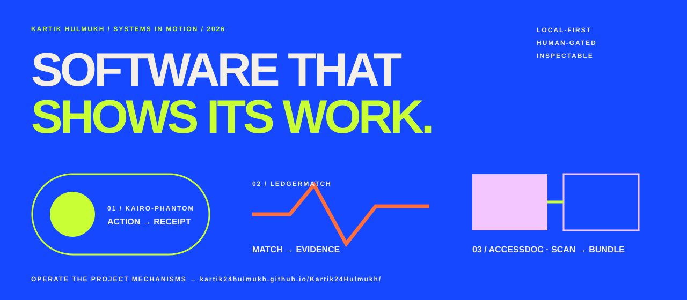

<picture>
  <source media="(prefers-color-scheme: dark)" srcset="./assets/hero-dark.svg">
  <source media="(prefers-color-scheme: light)" srcset="./assets/hero-light.svg">
  
</picture>

## I build software that shows its work.

Computer Engineering student in Mumbai. I build local-first tools that emit verifiable evidence — signed action receipts, deterministic reconciliation bundles, tamper-evident accessibility reports — so results can be checked without trusting the tool that produced them.

**Every project below ships a verification command. Run it instead of believing this page.**

[**Interactive profile →**](https://kartik24hulmukh.github.io/Kartik24Hulmukh/) · [LinkedIn](https://www.linkedin.com/in/kartik-hulmukh-74081236a/) · [Email](mailto:kartikhulmukh24@gmail.com)

---

### 01 · Kairo-Phantom — local actions, signed receipts

Local-first document automation with explicit human confirmation and Ed25519-signed, hash-chained action records. Current wedge: offline legal redlining whose output is checked by an independently runnable verifier — the tool never grades its own work.

```bash
python -m pytest tests/test_airgap_zero_egress.py -q
python tools/verify_receipts_external.py redline_output/audit_log.json
```

[Repository](https://github.com/Kartik24Hulmukh/Kairo-Phantom) · [Project site](https://kartik24hulmukh.github.io/Kairo-Phantom/) · [Claims register — including the claims this project refuses to make](https://github.com/Kartik24Hulmukh/Kairo-Phantom/blob/master/CLAIMS.md)

<sub>Status: pre-launch technical preview. Published results describe declared repository test surfaces, not certification or third-party validation.</sub>

### 02 · LedgerMatch — reconciliation that refuses to guess

A local, review-first engine that matches bank deposits to open invoices. When two allocations are equally valid it preserves the ambiguity as an exception for a human instead of silently choosing, and every run emits a deterministic, tamper-evident Reconciliation Evidence Bundle. Python standard library only — nothing to install.

```bash
python3 -m unittest discover -s tests -p 'test_*.py'   # full suite, no dependencies
python3 -m app.cli --bank demo_data/bank_statement.csv --invoices demo_data/invoices.csv \
  --out out_demo --currency USD --date-format YMD
python3 -m app.validate out_demo/evidence.json --checksum out_demo/evidence.sha256
```

[Repository](https://github.com/Kartik24Hulmukh/Ledgermatch)

<sub>Status: release candidate for local evaluation. Not an accounting system of record; ambiguous allocations are never auto-accepted.</sub>

### 03 · AccessDoc — accessibility scans, printed as evidence

Turns raw axe-core scan output into a tamper-evident evidence bundle in the formats regulators and procurement accept: PDF report, EN 301 549-mapped OpenACR, SARIF, VPAT draft, and an in-toto attestation whose digests cover every file.

```bash
python3 -m unittest discover -s tests -p 'test_*.py'
python3 cli.py bundle axe.json --out dist/bundle.zip
python3 cli.py verify dist/bundle.zip   # exit 0 = intact, 1 = tampered
```

[Repository](https://github.com/Kartik24Hulmukh/AccessDoc)

<sub>Status: open-source beta. Documents what a scan found, with explicit coverage limits; automated tools detect only part of WCAG issues, so it never claims conformance.</sub>

---

### Boundaries, published on purpose

Most software advertises what it can do. These projects also state what they will not claim: no certification, no conformance opinions, no silent auto-acceptance, and no AI grading its own output. If a published statement does not reproduce on your machine, that is a bug in the statement — report it.

[Challenge a statement](https://github.com/Kartik24Hulmukh/Kartik24Hulmukh/issues/new?template=challenge.yml) · [Submit a reproduction](https://github.com/Kartik24Hulmukh/Kartik24Hulmukh/issues/new?template=reproduction.yml)

### Current direction

Local-first agents, human confirmation gates, verifiable action records, and evaluation that treats "the model said it works" as inadmissible evidence.
